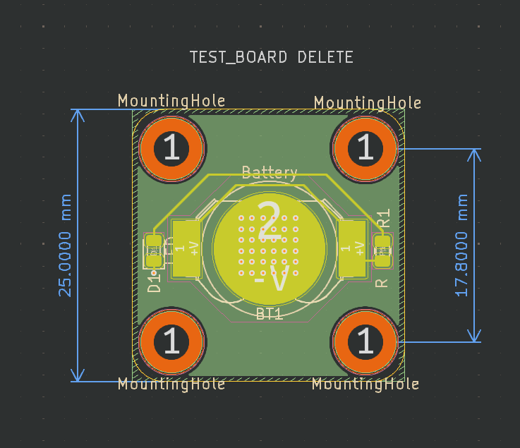

# watch

a cool table showing the workflow of all the kicad projects.
| project_name | DRC | ERC |
| ------------ | --- | --- |
| watch | [✅](https://github.com/sophiayduan/watch/actions/runs/30156732387/attempts/1#summary-89675794027)| [❌](https://github.com/sophiayduan/watch/actions/runs/30156732387/attempts/1#summary-89675794023) | 

This workflow will also run the design rules check on the PCB and schematic to ensure that you upload a working PCB. These reports are uploaded as summaries within the github [actions tab](https://github.com/sophiayduan/watch/actions/runs/30156732387). This template has a simple schematic PCB in it (because DRC fails on an empty PCB). Shown below is the example PCB.

besides from that the project also has:

- common predefined trace widths
- smallest vias size [JLCPBC allows](https://jlcpcb.com/capabilities/Capabilities#Drilling)
- custom net colours in the schematic editor
    - `red` for +V
    - `blue` for -V
    - `grey` for ground

contained in this template are:
---
- `.github/` : all files relating to github actions and other admin see [here](https://docs.github.com/en/communities/setting-up-your-project-for-healthy-contributions) for more example of what can be placed in it
    - `report_processing` : where the python scripts are stored for processing the json report data from kicad
    - `report_templates` : where the template for said reports are stored
    - `workflows/` : this is where the github actions are kept
        - `main.yaml` : the main github action that will auto generate all files required and run DRC and ERC
    - `rename.py` : the script for renaming the project
- `hardware/watch` : this is where the kicad files live
- `docs/` : this is where the generate docs are placed by default
    - `BOM/`     : where the bill of materials and price breakdown are kept
        - `bill_of_materials.csv`: the auto generated bom for the kicad project
        - `bom_report.md` : a report for the bill of materials
    - `watch_schematic.pdf` : the schematic for the kicad project, auto generated by the github action
- `production/` : this is where the auto generated gerbers for the kicad project are stored

- `res/` : where resources are stored for the README

- `.gitignore`: a slightly modified gitignore from the [standard one](https://github.com/github/gitignore/blob/main/KiCad.gitignore)

- `project_settings.yaml` : where the settings for this project is stored

- `README.md` : this file, suggest you change this one creating your project

## Credits
[@sirlilpanda](https://github.com/sirlilpanda)'s [kicad project template](https://github.com/sirlilpanda/kicad-project-template)
